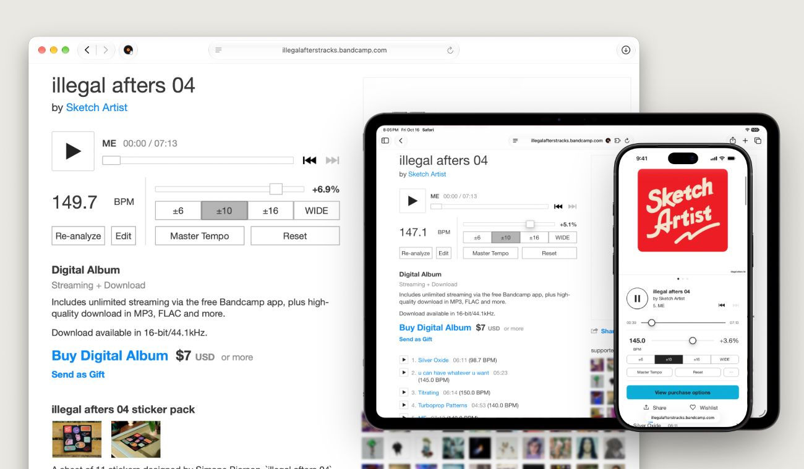

<picture>

  <source
    srcset="/images/tempo-adjust-hero-dark.png"
    media="(prefers-color-scheme: dark)"
  />
  
</picture>

[Tempo Adjust](/tempo-adjust) for Bandcamp and Discogs is now available for
Safari on Mac, iPhone, and iPad, as well as Firefox for Android!

I'm really excited about this update. I do a lot of my digging on the train,
so I've always wanted to detect BPMs on my phone the same way I can on my
desktop. Now I finally can, and so can you!

On Safari, Tempo Adjust is a single extension that works for both Bandcamp and
Discogs. Firefox and Chrome still have separate extensions (Bandcamp Tempo
Adjust and Discogs Tempo Adjust), but at some point they'll be merged into one.

Tempo Adjust is still free and open source on every platform.
[Tips are always appreciated](https://buymeacoffee.com/miseryconfusion).

[Get Tempo Adjust](/tempo-adjust)
